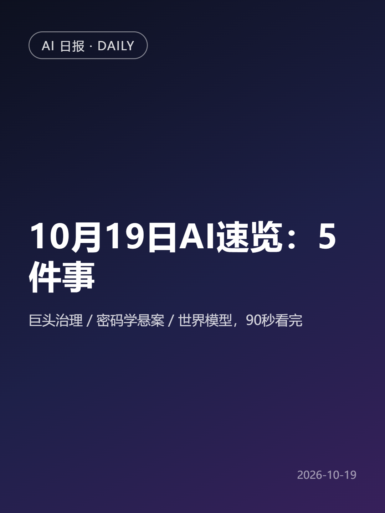
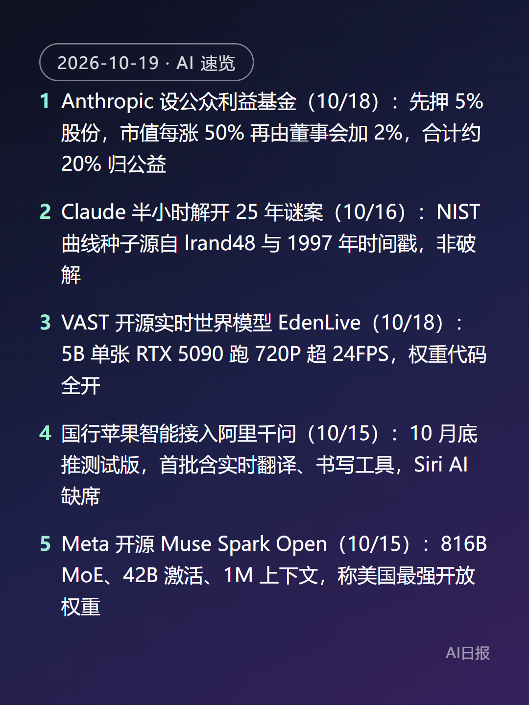

# xhs-daily-agent · 小红书每日 AI 速览：无人值守发布 Agent

每天定时唤醒一个 Agent，走完 **检索 → 逐条核实 → 成稿 → 排版出图 → 上传 → 发布 → 验收** 全链路，把一条图文笔记发到小红书上，全程无人工介入。

这个仓库记录的不是"内容运营"，而是**一个没有开放 API 的目标系统，如何被一个可长期无人值守的 Agent 稳定驱动**——包括 20 条踩过的失败模式，以及三次方案否决后才成立的架构。

<p align="center">
  
  
</p>

## 运行记录

| 指标 | 值 |
|---|---|
| 运行窗口 | 2026-09-14 → 2026-10-19（36 天） |
| 定时触发 | 29 次 |
| 成功发布 | **28 次** |
| 失败 | 1 次（模型 API 601s 超时，非流程缺陷） |
| 单次端到端耗时 | 4–8 分钟（含检索与原文核实） |
| 重复发布 | 0（发布前幂等校验） |

每一天的输入与产物都留在仓库里：`specs/<date>.json`（选题与来源）、`out/<date>/`（卡片 HTML、PNG、正文）。

## 它每天做什么

```
cron 09:00
   │
   ├─ ensure_edge_debug.py ──→ 幂等拉起独立 profile 的 Edge，监听 CDP 9222
   │                            （登录态常驻，不抢用户日常浏览器的 cookie 锁）
   │
   ├─ Agent: web_search ×3–4 组关键词（过去 24–48h）
   │         └─ 每条候选 web_extract 打开原文核实 → 核实不掉的直接丢弃
   │         └─ 写 specs/<date>.json（5 条要点 + 每条的真实来源 URL）
   │
   ├─ build_publish.py ──────→ cover.html / points.html / body.txt
   │                            （标题 >20 字告警截断；sources 缺 url 直接丢弃）
   │
   ├─ _render2.py ───────────→ 1080×1440 PNG（先固定 device metrics，PNG 3 次重试→JPEG 兜底）
   │
   ├─ _publish.py upload ────→ 切「上传图文」→ DOM.setFileInputFiles 塞 2 张图
   │   _publish.py fill ─────→ 标题 Input.insertText；正文走 tiptap editor.commands.setContent()
   │   _publish.py publish ──→ AX 树取按钮 → 鼠标事件 → 失败降级 Runtime.callFunctionOn(this.click())
   │
   └─ _verify.py ────────────→ 三判据验收：URL published=true / 审核中→已发布 / 无 permission_msg
```

封面卡、要点卡、正文全部由 `specs/*.json` 单一数据源生成，改内容只改 spec。

## 架构：为什么只能用 CDP

目标平台**没有开放发布 API**，也没有现成的 MCP server，浏览器自动化是唯一路径。但四个候选方案里前三个都不成立：

| 方案 | 否决原因 |
|---|---|
| 云端浏览器（如 browser-use 托管） | 每个任务新建实例、不传 profileId → 登录态每天丢，等于每天扫码 |
| 复制用户真实 profile（`use_real_profile`） | Windows 上 Chrome/Edge 独占锁 cookie 库，必须完全退出浏览器才能复制；定时任务里没人能批准关浏览器 |
| ~~Playwright 直接开新浏览器~~ | 同上，新 profile 无登录态；每次扫码不可接受 |
| **独立 user-data-dir + `--remote-debugging-port`** ✅ | 独立 profile 不与日常浏览器抢锁，登录态跨天保留；Agent 通过 CDP 直接驱动这个常驻实例 |

两个必须一起做的细节：

- `--no-proxy-server`：本机系统代理经常是死的，不放行会导致每页 `ERR_PROXY_CONNECTION_FAILED`。
- **headed 常驻窗口**（不用 headless）：headless 更容易被判风控，且登录态失效时需要人工在那个窗口里扫码/输密码——即"人做登录，Agent 做发布"的边界。

## 可靠性设计

| 机制 | 做法 |
|---|---|
| **三级降级** | 坐标点击（`Input.dispatchMouseEvent`）→ AX 树定位（`Accessibility.getFullAXTree` + `DOM.getBoxModel`）→ 运行时直调（`DOM.resolveNode` + `Runtime.callFunctionOn(this.click())`） |
| **三判据验收** | ① URL 出现 `published=true` ②「审核中」列表不再有、迁移到「已发布」 ③ 卡片无 `permission_msg`（按 y 坐标判归属，缺省才算公开可见） |
| **幂等** | 任何重试前先查笔记列表有无同名条目；发布按钮点了没反应也不盲目重发，先确认服务端是否已收到 |
| **fail-closed** | 三条降级都失败 → 点「暂存离开」把内容存进草稿箱保住成果，报告写明卡在哪一步，绝不反复点发布 |
| **自愈** | `ensure_edge_debug.py` 幂等：CDP 已通就不动，未通就重拉，最多等 40s |
| **登录态边界** | 重定向到 `/login?redirectReason=401` 立即停手报错，验证码/密码永不经过 Agent |

## 踩过的坑（20 条完整版见 [docs/failure-modes.md](docs/failure-modes.md)）

摘要：

1. 发布按钮在 **closed shadow DOM** 里——`querySelectorAll('*')` 和手写 shadow 遍历都找不到，只有 Accessibility 树能找到。
2. 坐标点击**会随机失效**：同一坐标 `document.elementFromPoint` 就是那个按钮，`Input.dispatchMouseEvent` 连点两次毫无反应且**确认没发出请求**；`Runtime.callFunctionOn(this.click())` 一次成功。
3. 编辑器（tiptap）**键事件全线不可靠**：`press_key("Enter")`、`Input.dispatchKeyEvent`、`execCommand('insertParagraph')` 全部无效，414 字挤进一个 `<p>`；只能拿实例 `editor.commands.setContent()` 写真实段落。
4. **DPR 不固定**（实测见过 1.5 与 1.125）：截图是设备像素、DOM/box model 是 CSS 像素，混用会让标题框聚焦失败且**静默不报错**（回读 `input.value` 为空）。稳妥做法是坐标读取与点击在同一 CDP 调用内完成，全程不硬编码 DPR。
5. 草稿只存在**当前浏览器本地**——换个浏览器 profile 就看不到，所以那个 `edge-profile/` 不能删。
6. 话题标签会退化成**纯文本不可点**（`a[href*="topic"]` 为 0），因为键事件通路不可靠、没能从下拉里选中真话题。这是已知缺陷。

## 快速开始

```bash
pip install websockets

# 1. 拉起专用浏览器（首次需要人工登录一次，登录态落进 edge-profile/）
python ensure_edge_debug.py

# 2. 由 spec 生成素材
python build_publish.py specs/2026-10-19.json

# 3. 渲染成 1080×1440 PNG
python _render2.py 2026-10-19

# 4. 分阶段发布（每阶段可单独重跑，失败不会重复提交）
python _publish.py upload   2026-10-19
python _publish.py fill     2026-10-19
python _publish.py publish  2026-10-19
python _publish.py verify   2026-10-19

# 失败兜底：存进草稿箱
python _publish.py draft    2026-10-19
```

`_cdp.py` 是一个约 100 行的同步 CDP 客户端（`websockets` + `urllib`），不依赖 Playwright / Selenium，也不依赖任何 Agent 框架——脚本层可以独立运行。Agent 层（定时、检索、判断、报告）由定时任务 + 提示词承担。

## 已知限制

- **登录态需要人工维护**：cookie 过期后必须在那个可见 Edge 窗口里重新登录。这是刻意的边界，不是未完成项。
- **话题标签不可点**（见坑 6），需要手机端确认实际效果。
- **依赖页面结构**：平台的 `.creator-tab` / `.note-card` / `permission_msg` 等选择器一变，验收逻辑就要跟着改。
- **内容侧不在本仓库的评价范围**：这里只解决"怎么稳定发出去"，不解决"写得好不好"。

## 说明

个人自动化练习项目，用于研究"无 API 站点上的 Agent 工程化"。请勿用于批量灌水或违反目标平台服务条款的用途。
