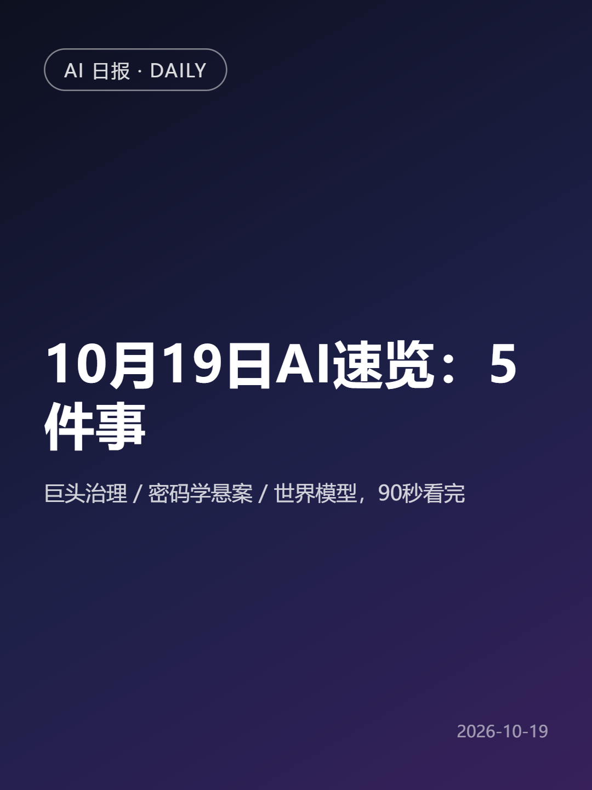
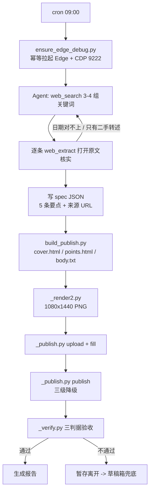

# 从 0 到持续运行：用 Hermes Agent + Python 搭一个小红书 AI 资讯自动发布系统

每天 9 点，一个 Agent 会自己去搜当天的 AI 新闻、逐条打开原文核实日期、写成 5 条要点、渲染成两张 1080×1440 的卡片、上传到小红书创作平台、填标题正文、点发布，然后回头确认这篇笔记到底有没有真的发出去、是不是公开可见。

这套东西从 2026-09-14 跑到 2026-11-02，一共发出 35 篇，中间失败 3 次。

这篇文章想讲清楚两件事：**一个没有开放 API 的站点，怎么被自动化到可以无人值守**；以及**哪些活该交给 Agent，哪些活必须写成确定性脚本**。代码全部开源在文末。



## 一、为什么做这个项目

起因很具体：我每天要看 AI 圈的更新，读完又觉得"不如顺手整理出来"。但手工做这件事的成本不在写，在**重复的机械动作**——搜、点开、核对日期、排版、上传、填标题、点发布、确认发没发出去。全是可枚举的步骤，一步不能少，而且每天一模一样。

我的判断是：这里适合自动化的不是"内容创作"，是**这条链路的执行**。所以从第一天起，我就没打算让模型自由发挥，而是把整件事拆成 8 个有明确输入输出的步骤，能落成代码的全落成代码，只把"判断"留给模型。

结果就是现在这个形态：cron 定时叫醒一个 Agent，Agent 按一份技能文档执行，确定性动作调用 9 个 Python 脚本（约 30 KB，最大的一个 205 行），浏览器交互全部走 CDP。

## 二、先看效果，再说怎么做的

数据全部来自仓库里的 `specs/`（输入）、`out/`（产物）和任务运行记录：

| 指标 | 值 |
|---|---|
| 运行窗口 | 2026-09-14 → 2026-11-02（50 天） |
| 任务运行记录 | 39 份，其中 3 份以 `FAILED` 结束 |
| 线上发布 | 35 次（每个 spec 对应一次发布） |
| 无运行日 | 15 天（网关没启动，不是任务失败） |
| 单次到笔记上线 | 3–7 分钟（3 个可核对样本） |
| 单次到任务收尾 | 6.6–8.4 分钟（含验收与报告） |
| 累计来源 URL | 172 个（平均每条笔记 4.91 个） |
| 重复发布 | 0 |

这里要如实说清两件事：

**失败 3 次**，其中 2 次是模型侧超时（`Non-streaming API call timed out after 601s`、任务空闲 7382 秒被判定超时），1 次是第一天搭建时的调试报错。**没有一次是"内容发错了"或"重复发布"**。

**15 天没有运行**不等于 15 次失败——是我本机的网关没起来，cron 压根没触发。把它算进成功率是不诚实的，所以我单独列出来。

另外，这个项目的"效果"只到工程层面。**内容侧的数据没有说服力**：账号阅读量长期在两位数到三位数之间，这跟系统稳定性无关，是选题和内容能力的问题。我不打算把这条包装成产品验证。

## 三、架构：四个方案里只有一个能活

小红书没有开放的发布 API，也没有现成的 MCP server，浏览器自动化是唯一路径。我试过（或评估过）四个方案，前三个都死了：

| 方案 | 为什么不行 |
|---|---|
| 云端托管浏览器 | 每个任务新建实例、不传 profileId，登录态天天丢，等于每天扫码 |
| 复制用户真实 profile | Windows 上 Edge/Chrome 独占锁 cookie 库，必须先完全退出浏览器才能复制；定时任务里没人能批准关浏览器 |
| Playwright 开新浏览器 | 新 profile 没有登录态，同样回到每天扫码 |
| **独立 user-data-dir + `--remote-debugging-port`** | 独立 profile 不跟日常浏览器抢锁，登录态跨天保留，Agent 通过 CDP 直接驱动这个常驻实例 |

第四个方案成立，靠的是两个细节：

1. `--no-proxy-server`：本机系统代理经常是死的，不排除掉会变成每页 `ERR_PROXY_CONNECTION_FAILED`。
2. **headed 常驻窗口**，不用 headless：headless 更容易被判风控，而且登录态失效时需要人工在那个可见窗口里重新登录——这就是"人负责登录、Agent 负责发布"的边界。

启动逻辑就是一个幂等脚本，代码在 `ensure_edge_debug.py`：CDP 端点已经能用就什么都不做，不能用就拉起来，最多等 40 秒。

```python
def main() -> int:
    if cdp_version(PORT):
        print(f"OK: CDP already listening on 127.0.0.1:{PORT}")
        return 0                      # 幂等：已在则不重启
    edge = find_edge()
    os.makedirs(PROFILE_DIR, exist_ok=True)
    args = [
        edge,
        f"--remote-debugging-port={PORT}",
        f"--user-data-dir={PROFILE_DIR}",
        "--no-proxy-server",          # 系统代理常死，绕开
        "https://creator.xiaohongshu.com/publish/publish",
    ]
    subprocess.Popen(args, ...)
```

整体分工是这样的：



## 四、核心流程：一份 JSON 驱动的流水线

整条链路只有一个数据源：`specs/<日期>.json`。改内容只改这个文件。

```json
{
  "date": "2026-11-02",
  "title": "11/2 AI速览：5件事",
  "bullets": ["OpenAI 悄悄灰度 GPT-6.2 Astra：...", "..."],
  "tags": ["AI日报", "大模型", "人工智能"],
  "sources": [
    {"name": "arXiv:2610.19128(CLASHarness)", "url": "https://arxiv.org/abs/2610.19128"}
  ]
}
```

这个 schema 里有一条是**被事故逼出来的**：`sources` 必须带可访问的 `url`。

第一天（09-14）我只记了来源名称——"联合早报"、"某个 Hugging Face 合集"。等想回溯某条说法的出处时，链接已经找不回来了。从那天起，`specs` 要求每条要点对应一个真实 URL，而渲染脚本会在缺 url 时直接丢掉该条目：

```python
def source_line(spec):
    """只有 name 没有 url 的来源等于永久丢失链接，直接丢弃。"""
    parts = []
    for i, s in enumerate(spec.get("sources") or []):
        name = str(s.get("name") or "").strip()
        url = str(s.get("url") or "").strip()
        if not url:
            print(f"WARN: sources[{i}] {name!r} 缺 url，已丢弃（来源名无法回溯核实）")
            continue
        if not url.startswith("http"):
            continue
        parts.append(f"{name} {url}".strip())
    return "来源：" + " / ".join(parts) if parts else ""
```

效果可查：仓库里 35 份 spec，除 09-14 那一份，其余 34 份全部带 URL，累计 172 个。

渲染层是 `build_publish.py`，一份 spec 出三个文件：`cover.html`、`points.html`、`body.txt`。它同时守住两个平台硬约束——标题 20 字（超了告警截断）、正文 1000 字（超了告警），避免把内容发出去之后才发现被截。

## 五、最难的不是发布，是让机器真的点到那个按钮

我原本以为难点在"内容生成"，实际耗掉最多时间的全是浏览器这一层。三个坑值得单独讲。

### 坑 1：发布按钮在 closed shadow DOM 里

`document.querySelectorAll('*')` 找不到它，手写递归遍历 shadow root 也找不到。更坑的是有个假象：页面 `innerHTML.indexOf('暂存')` 是有值的，但那只是内联脚本里的字符串常量，不是按钮。

唯一稳定的路径是 Accessibility 树：

```python
nodes = cdp("Accessibility.getFullAXTree")["nodes"]
btn = [n for n in nodes
       if (n.get("name") or {}).get("value") == "暂存离开"
       and (n.get("role") or {}).get("value") == "button"][0]
# backendNodeId -> box model -> CSS 像素坐标
m = cdp("DOM.getBoxModel", backendNodeId=btn["backendDOMNodeId"])["model"]["content"]
```

拿到 `backendDOMNodeId` 之后，还能一路降级到直接在运行时里点它：

```python
def click_by_dom(c, name):
    """最后一级降级：拿到节点对象，直接在页面运行时里调 click()。"""
    nodes = c.ax_buttons(name)
    if not nodes:
        return "no node"
    nid = nodes[-1]["backendDOMNodeId"]
    r = c.send("DOM.resolveNode", backendNodeId=nid)
    obj = r["object"]["objectId"]
    res = c.send("Runtime.callFunctionOn", objectId=obj,
                 functionDeclaration="function(){ this.click(); return 'clicked'; }",
                 returnByValue=True)
    return res.get("result", {}).get("value")
```

这条降级链是必要的，不是过度设计：**同一份代码里，坐标点击点标题框一次成功，点发布按钮两次毫无反应**——没有弹窗、没有 toast、URL 不变，确认请求根本没发出去。换成 `Runtime.callFunctionOn` 一次就过。

### 坑 2：编辑器的键事件全线不可靠

正文区是 tiptap/ProseMirror。`press_key("Enter")` 会把 414 个字全挤进同一个 `<p>`；`Input.dispatchKeyEvent`（keyCode 13 + `\r`）、`Shift+Enter`、`execCommand('insertParagraph')` 我都试过，全部无效。

最后只能拿编辑器实例一次性写入真实段落：

```javascript
const ed = document.querySelector('div[contenteditable=true].ProseMirror').editor;
ed.commands.setContent('<p>第一段</p><p>第二段</p>', true);  // true = 触发更新事件
// 写完必须回读：innerText.length 和 children.length 双确认
```

这件事的教训是：**不要假设"模拟用户输入"等于"改到了底层状态"**。对富文本编辑器，最可靠的做法是改它的文档模型，然后回读校验。

### 坑 3：坐标空间会打架，而且失败是静默的

这台机器上 `window.devicePixelRatio` 我实测见过 **1.5 和 1.125** 两个值（取决于窗口和缩放）。截图 PNG 的宽度是 CSS 宽度乘 DPR，也就是说：**截图是设备像素，`DOM.getBoxModel` 是 CSS 像素**。

混用的后果不是报错，是静默失败——标题框点了两次都没聚焦（`document.activeElement` 还是 `BODY`），回读 `input.value` 是空的，但同样的坐标 `document.elementFromPoint` 明明就是那个输入框。

所以现在的规则是：不硬编码 DPR，坐标读取和点击在同一个 CDP 调用里完成（两者同属 CSS 像素空间），并且**每次写页面之后都回读校验**。

截图环节也有类似的坑：不先 `Emulation.setDeviceMetricsOverride(1080, 1440)` 就会截到窗口视口，卡片被裁；而这个 override 会跨导航保留，渲染完必须 `clearDeviceMetricsOverride()`，否则后续所有坐标判断都是错的。

## 六、怎么知道"真的发出去了"

这是我认为整个项目最值得抄的一点：**不要用"看起来成功了"当验收**。

我的验收有三条判据，缺一不可：

1. 发布后 URL 出现 `published=true`；
2. 在笔记管理页按状态筛选：「审核中」里没有、「已发布」里有；
3. 这条卡片上没有 `permission_msg`（文案「仅自己可见」），即公开可见。

第三条最容易做错。`permission_msg` 不是挂在标题后面，而是**跟在自己所属卡片的下方**，所以不能用 innerText 的行序去猜，得按 y 坐标判归属。相关逻辑在 `_verify.py`：

```javascript
const titles = Array.from(document.querySelectorAll('.note-card__title')).map(e => {
  const r = e.getBoundingClientRect();
  return {t: e.innerText.trim(), y: Math.round(r.y)};
});
const perms = Array.from(document.querySelectorAll('[class*=permission]')).map(e => {
  const r = e.getBoundingClientRect();
  return {t: e.innerText.trim(), y: Math.round(r.y)};
});
// 标题 y 附近 ±120px 内出现 permission 元素 -> 这条是私密
```

两条配套的稳定性设计：

- **幂等**：任何重试之前，先查笔记列表里有没有同名条目。按钮点了没反应也绝不盲目重发，先确认服务端到底收没收到。这是"重复发布 0 次"的来源。
- **fail-closed**：三级降级都失败，就点「暂存离开」把内容存进草稿箱，保住这一天的成果，报告里写清卡在哪一步。宁可今天不发，也不赌一次。

## 七、三次失败与复盘

**10-15**：`RuntimeError: Non-streaming API call timed out after 601s`。模型侧 601 秒无响应，任务直接中断，那天没有产出。这个我没能修——它不在我的代码里。

**10-12**：`TimeoutError: Cron job idle for 7382s (limit 600s)`。任务卡在等一个非流式 API 响应，超时被判定失败。但那天笔记其实发出去了，是收尾阶段挂的。

**09-14**：第一天，`RuntimeError: Request timed out`。搭建期报错，同一天重试多次才跑通。

复盘下来，3 次失败里 **0 次是页面逻辑错误**。这也印证了一件事：浏览器自动化的失败模式很吵（点不动、没反应），而模型侧的失败很安静（就是超时）。后者更难防，只能靠超时预算和幂等兜住。

## 八、AI 和脚本的分界线

这部分是我最想分享的，因为它决定了这套东西能不能长期跑。

**交给 Agent 的**：搜什么关键词、哪条新闻值得选、这 5 条怎么排序、标题怎么写、核实不到来源时要不要放弃这一条。这些没有确定答案，而且是每天变的。

**写成脚本的**：启动浏览器、生成 HTML、截图、上传文件、填字段、点按钮、判验收。这些有唯一正确做法，而且错一次要重来。

一条经验：**任何"必须每次都对"的动作，都不该让模型生成**。让模型决定"发什么"，让代码决定"怎么发"。

另一条经验是关于调试的。这个项目有一份 20 条的失败模式文档（`docs/failure-modes.md`），每一条都是踩出来的，格式统一：现象 → 怎么确认 → 怎么绕。它比代码更值钱，因为下次页面改版时，我照着这份清单逐条排查就能定位。

举个具体的：09-14 那次丢了所有来源链接，这条被写进文档后，`sources` 才变成强制字段，渲染期才加了丢弃逻辑。**事故 → 文档 → 代码约束**，这个循环跑了 20 次。

还有一个真实细节：有一段时间本机的系统代理挂了，Agent 的搜索工具全部返回失败。当时的处理不是等，而是写了个 76 行的直连抓取兜底（`_research.py`，Bing 搜索 + 正文抽取，全部绕过代理）。这个脚本后来只在代理坏的时候用——但它证明了一点：**AI 编码真正省时间的地方，是写这种"一次性、够用、不用维护"的胶水代码**，而不是写核心逻辑。

## 九、局限，说清楚

1. **登录态必须人工维护**。cookie 过期后要在那个可见的 Edge 窗口里重新登录，验证码和密码永远不经过 Agent。这是刻意的边界。
2. **话题标签会退化成纯文本**（`a[href*="topic"]` 数量为 0），因为键事件通路不可靠，没能从下拉里选中真话题。已知缺陷，未解决。
3. **强依赖页面结构**。`.creator-tab`、`.note-card`、`permission_msg` 这些选择器一变，上传和验收逻辑都要跟着改，目前没有针对它们的断言。
4. **内容质量不在这个系统的解决范围内**。它保证"发得出去"，不保证"有人看"。这两件事我一开始也混在一起了。
5. **平台规则风险**。自动化操作第三方平台属于灰色地带，同一个账号高频发布也有风控风险。我的用法是每天一条、真人内容、带来源，但这不是一个可以推广的做法。

## 十、总结

如果让我用一句话概括这个项目：**它不是一个会写内容的 Agent，是一条会自己跑完的流水线，Agent 只是这条流水线上的决策环节。**

真正花时间的从来不是"让 AI 写 5 条新闻"，而是让机器在一个为人类设计的页面上，稳定地完成"点这个按钮、填那个框、确认结果"。这块东西没有 API 文档可查，只能靠在 DevTools 里一层层试出来，然后把它固化成文档和降级链。

把失败写下来，比把功能写在 README 上更有用。20 条失败模式，就是这个项目最实的资产。

**项目地址**：https://github.com/Peng2505/xhs-daily-agent
**实际运行的账号**：https://xhslink.cn/o/7MwjqB2LIEI

---

## 附：候选标题

1. 《没有 API 的站点怎么自动化：CDP + Python 把「检索→配图→发布→验收」跑成定时任务》
2. 《35 次无人值守发布之后：一个 AI 资讯 Agent 的架构、20 个坑和它的边界》
3. 《我让 Agent 每天自己发一条小红书：聊透 shadow DOM、坐标点击和验收判据》

## 附：摘要

小红书没有发布 API。用 CDP 驱动一个常驻登录态的浏览器，把检索、配图、发布、验收跑成定时任务，处理 shadow DOM、坐标点击失效与编辑器写入。50 天 35 次无人值守发布，失败 3 次。

> 备选（含结论句，111 字符）：小红书发布无 API：CDP 驱动常驻登录浏览器打通检索、配图、发布、验收，解决 shadow DOM 定位、点击失效、tiptap 写入与三判据验收。50 天 35 次发布，失败 3 次。判断给 Agent，动作给脚本。

## 附：建议标签

`Agent` `Python` `自动化` `AI编程` `爬虫`（备选：`DevTools` `CDP`）

---

> 说明：文中所有数字均可在仓库的 `specs/`、`out/`、`docs/failure-modes.md` 中对应查到；运行时长取自任务记录时间戳与笔记发布时间的差值，样本数已在文中标注。文中代码为节选（省略了日志、异常分支与重试循环），完整实现见仓库。文中不含任何 Cookie、Token、账号凭证。
